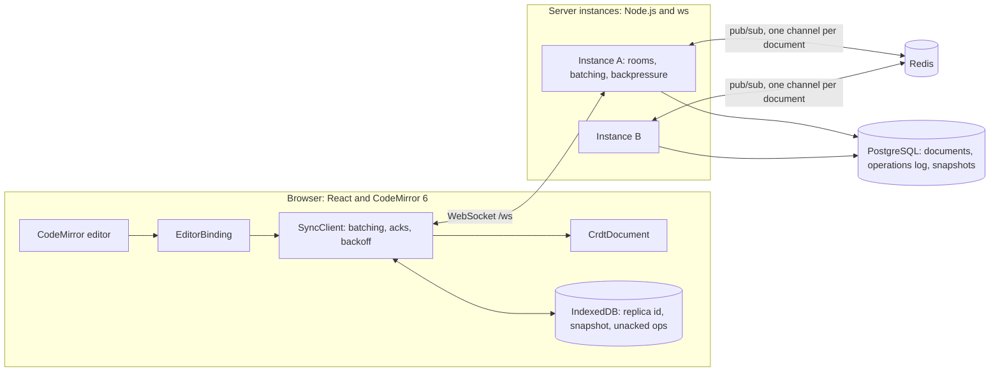
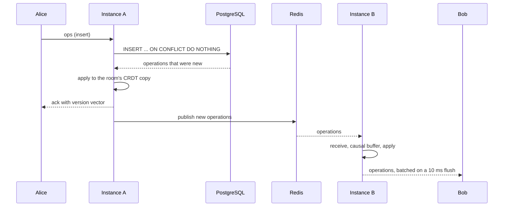
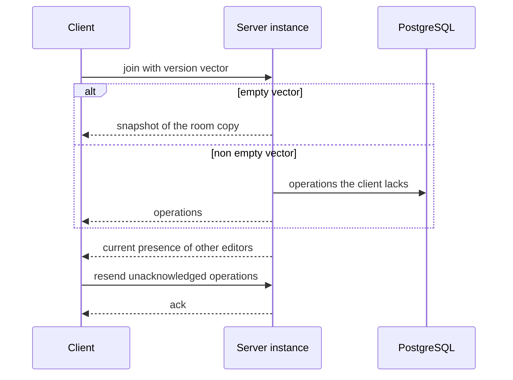

# Architecture

This page shows how the pieces fit together. The reasoning behind the CRDT itself is in design.md.

## Components

Postgres is the source of truth. Redis only carries fan-out, so losing it never loses an edit.

## Life of an edit across two instances

Only operations that were new to Postgres are published, so a client resending after a reconnect does not cause duplicate fan-out.

## Joining, catching up and resending

Resending is safe because the operation log is idempotent on (document, replica, counter) and the CRDT ignores duplicates.

## Loading a room

A room is loaded the first time a client joins it on an instance:

1. Subscribe to the document's Redis channel.
2. Load the latest snapshot, if any.
3. Replay every logged operation that the snapshot's version vector does not cover.

Replay is by version vector, not by a sequence number cursor. With several writers, the log's sequence order is not the commit order, so "everything after last_seq" can skip an operation that committed late. The multi instance integration test covers this case.

## Presence

Presence is ephemeral. Cursors are stored as element ids, not offsets, so they follow the text through concurrent edits. Presence travels over the same Redis channel but is never written to Postgres. When a client joins, its instance asks the others to republish the presence of their local clients.

## Backpressure and batching

- Outbound operations are batched per client and flushed every 10 ms, at most 2000 per message.
- If a socket has more than 1 MiB buffered, flushing is delayed. Above 16 MiB the socket is terminated.
- A client whose outbox passes 200,000 operations is closed as a slow consumer and resyncs when it reconnects.

## Failure behaviour

| Situation | What happens |
| --- | --- |
| Redis unreachable | Edits still persist to Postgres and reach clients on the same instance. When the subscriber reconnects, every loaded room resyncs from the log. |
| Redis publish fails once | Logged. Other instances do not learn about those operations until their next resync (no periodic reconciliation yet). |
| Server instance restarts | Rooms reload from snapshot plus log. Clients reconnect with backoff and resend unacknowledged operations. |
| Client offline | Edits go to a queue persisted in IndexedDB together with the replica id and a snapshot, so a reload keeps them. On reconnect they are resent and merged. |
| Slow client | See backpressure above. |

## Known limitations

- Rooms are never unloaded from memory on a server instance.
- The operation log is never pruned, and snapshots are written every N operations by whichever instance applied them.
- If an instance crashes, the presence of its clients stays visible on other instances until those editors reconnect elsewhere.
- Tombstone compaction exists in the CRDT library but is not wired into the server, because it is only safe when every replica is known to have seen the same operations.
